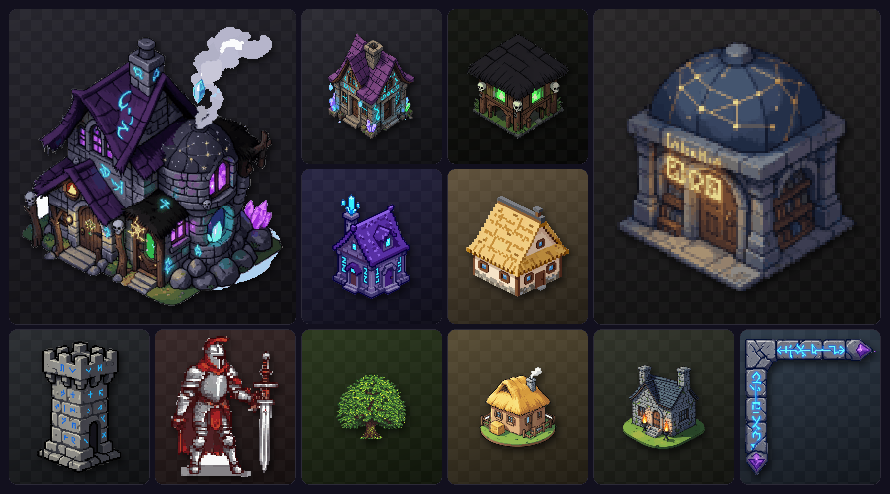
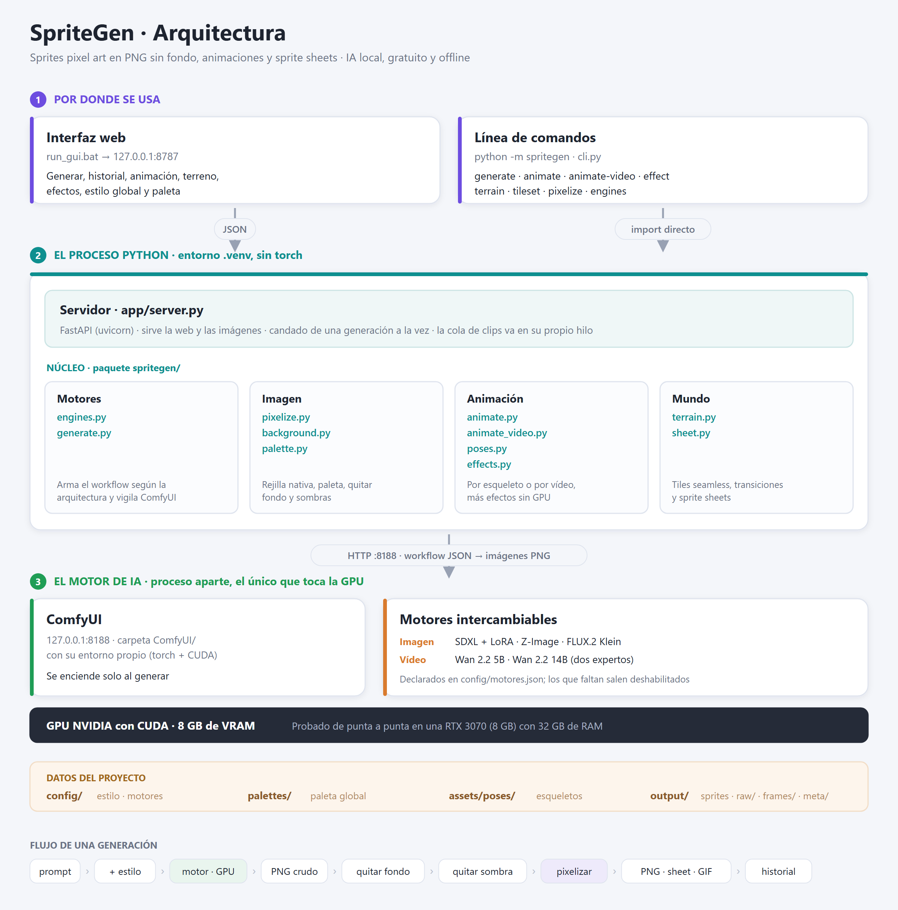

# SpriteGenIA

[](https://www.python.org/)
[](https://fastapi.tiangolo.com/)
[](https://docs.pydantic.dev/)
[](https://python-pillow.org/)
[](https://numpy.org/)
[](https://github.com/comfyanonymous/ComfyUI)
[](https://pytorch.org/)
[](https://developer.nvidia.com/cuda-toolkit)
[](#)
[](#)
[](#motores-de-generación-intercambiables)
[](#)
[](#)



<sub>Todo lo de arriba salió de esta herramienta, en PNG con fondo transparente. El caballero y el árbol son fotogramas de sus animaciones.</sub>

Pipeline local para generar sprites pixel art detallados: PNG con fondo transparente, animaciones y sprite sheets con un estilo consistente entre todos ellos. Corre en tu propia GPU con herramientas gratuitas, sin servicios de pago ni suscripciones.

[](docs/arquitectura.md)

<sub>Cómo funciona por dentro: la interfaz y la línea de comandos entran al mismo núcleo Python, y este habla con ComfyUI —el único proceso que toca la GPU—. Detalle completo en <b><a href="docs/arquitectura.md">docs/arquitectura.md</a></b>.</sub>

## ¿Cómo ejecutarlo?

**Requisitos**: 
- Windows 10/11 
- Python 3.13 
- GPU NVIDIA con 8 GB de VRAM y drivers CUDA 
- 12 GB RAM minimo, recomendado 32 o más.
- 15 GB libres para lo mínimo (~120 GB con todos los motores descargados).

**1. Entorno del proyecto** (la GUI, el servidor y la CLI; solo librerías ligeras):

```powershell
python -m venv .venv
.venv\Scripts\python.exe -m pip install -r requirements.txt
```

**2. Motor de IA** (ComfyUI, con su **propio** entorno y su torch para CUDA. Son varios GB). Se clona **dentro** de la carpeta del proyecto: el código lo espera en `ComfyUI\`. El torch se instala antes que el `requirements.txt` de ComfyUI para que pip no ponga la versión sin CUDA:

```powershell
git clone https://github.com/comfyanonymous/ComfyUI.git
python -m venv ComfyUI\.venv
ComfyUI\.venv\Scripts\python.exe -m pip install torch torchvision torchaudio --index-url https://download.pytorch.org/whl/cu126
ComfyUI\.venv\Scripts\python.exe -m pip install -r ComfyUI\requirements.txt
```

Si tus drivers usan otra versión de CUDA, cambia `cu126` por la que corresponda ([índices de PyTorch](https://pytorch.org/get-started/locally/)).

**3. Extensión para modelos cuantizados** (`.gguf`; la necesitan los motores de video 14B y los Klein con encoder propio):

```powershell
git clone https://github.com/city96/ComfyUI-GGUF.git ComfyUI\custom_nodes\ComfyUI-GGUF
ComfyUI\.venv\Scripts\python.exe -m pip install gguf sentencepiece
```

**4. Modelos.** No se distribuyen con el proyecto: se descargan a mano y se dejan en `ComfyUI\models\<carpeta>`. Con estos dos ya se puede generar (motor `sdxl_pixelart`, el de por defecto):

| Archivo | Carpeta | Descarga | Tamaño |
|---|---|---|---|
| `sd_xl_base_1.0.safetensors` | `checkpoints` | [stabilityai/stable-diffusion-xl-base-1.0](https://huggingface.co/stabilityai/stable-diffusion-xl-base-1.0) | 6,5 GB |
| `pixel-art-xl.safetensors` | `loras` | [nerijs/pixel-art-xl](https://huggingface.co/nerijs/pixel-art-xl) | 0,2 GB |

Los demás motores son opcionales y se activan solos en la GUI en cuanto aparecen sus archivos:

| Motor | Archivos (carpeta ← repo) | Tamaño |
|---|---|---|
| `zimage_turbo` | `z_image_turbo_bf16.safetensors` → diffusion_models · `qwen_3_4b.safetensors` → text_encoders · `split_files/vae/ae.safetensors` → vae **renombrado a `z_image_ae.safetensors`** — todos de [Comfy-Org/z_image_turbo](https://huggingface.co/Comfy-Org/z_image_turbo) | 19 GB |
| `klein4b` | `flux-2-klein-4b-fp8.safetensors` → diffusion_models, de [black-forest-labs/FLUX.2-klein-4b-fp8](https://huggingface.co/black-forest-labs/FLUX.2-klein-4b-fp8) · `qwen_3_4b.safetensors` (el mismo de Z-Image) · `flux2-vae.safetensors` → vae | 12 GB |
| `wan22_14b_pixel` | Los dos expertos `Wan2.2-I2V-A14B-{High,Low}Noise-Q5_K_M.gguf` → diffusion_models, de [QuantStack/Wan2.2-I2V-A14B-GGUF](https://huggingface.co/QuantStack/Wan2.2-I2V-A14B-GGUF) · `umt5_xxl_fp8_e4m3fn_scaled.safetensors` → text_encoders · `wan_2.1_vae.safetensors` → vae · los dos LoRA `lightx2v` → loras, de [Comfy-Org/Wan_2.2_ComfyUI_Repackaged](https://huggingface.co/Comfy-Org/Wan_2.2_ComfyUI_Repackaged) · `wan2.2_pixel_animate.safetensors` → loras (Civitai) | 31 GB |
| `wan22_5b` | `wan2.2_ti2v_5B_fp16.safetensors` → diffusion_models · `wan2.2_vae.safetensors` → vae · `umt5_xxl...` (el mismo de arriba), de [Comfy-Org/Wan_2.2_ComfyUI_Repackaged](https://huggingface.co/Comfy-Org/Wan_2.2_ComfyUI_Repackaged) | 17 GB |

En los repos de Comfy-Org los archivos cuelgan de `split_files/`. Varios motores comparten archivo (`qwen_3_4b`, `umt5_xxl`), así que se descarga una sola vez.

Dos archivos no tienen repo oficial y hay que buscarlos por nombre: `flux2-vae.safetensors` (empaquetado de terceros para ComfyUI; el VAE oficial de Black Forest Labs se publica con otro nombre y otro tamaño) y `wan2.2_pixel_animate.safetensors`, que está en Civitai y **requiere iniciar sesión**.

**5. Arrancar**: doble clic en **`run_gui.bat`** → se abre `http://127.0.0.1:8787`. ComfyUI se enciende solo la primera vez que generes (tarda ~1 min); `stop_comfyui.bat` lo apaga y libera la RAM.

Para comprobar qué motores están completos y qué archivo falta a cada uno:

```powershell
.venv\Scripts\python.exe -m spritegen engines
```

<sub>Verificado con Python 3.13.13, torch 2.13.0+cu126, ComfyUI v0.33.0 y la extensión ComfyUI-GGUF (gguf 0.19.0, sentencepiece 0.2.2) en Windows 11 con una RTX 3070 (8 GB de VRAM) y 32 GB de RAM.</sub>

## Idea central

El pixel art detallado **no se dibuja a 1000×1000**: se trabaja a una resolución nativa (64–320 px de rejilla real) y se escala ×4–×8 con *nearest-neighbor* para obtener el PNG final grande y nítido.

El flujo completo es:

```
prompt → imagen IA (estética pixel art) → pixelizador (rejilla + paleta reales) → PNG / sprite sheet
```

La consistencia de estilo entre todos tus sprites NO depende del prompt. Se ancla con cuatro cosas fijas:

1. **Mismo modelo + mismo LoRA de pixel art** (misma "mano de artista").
2. **Plantilla de prompt**: prefijo de estilo fijo + solo cambia la descripción del contenido.
3. **Paleta global**: todos los sprites se cuantizan a la misma paleta (`palettes/`).
4. **Misma rejilla nativa por categoría** (ej. personajes 128 px, edificios 256 px) y mismo factor de escala.

## Fases del proyecto

- [x] **Fase 1 — Pixelizador** (`spritegen/`): convierte cualquier imagen en pixel art con rejilla, paleta y transparencia reales.
- [x] **Fase 2 — Generación local**: ComfyUI + SDXL + LoRA pixel art corriendo en tu GPU (`spritegen generate`).
- [x] **Fase 3 — Poses y animación**: ControlNet (OpenPose) + esqueletos procedurales → ciclos de animación con sprite sheet y GIF (`spritegen animate`).
- [ ] **Fase 4 — LoRA propio**: entrenar un LoRA con tus 30–50 mejores sprites para fijar el estilo definitivamente.

## Interfaz gráfica

Todo el proyecto se maneja desde la interfaz web (`run_gui.bat`): escribir el prompt, generar, iterar con semillas (repetir/variación), ver el historial con los parámetros de cada sprite, comparar el sprite final con la imagen cruda de la IA, editar y guardar el estilo global, fijar la paleta global desde un sprite aprobado, y apagar el motor de IA para liberar RAM (se enciende solo al volver a generar).

Para **eliminar generaciones**: pasa el mouse sobre una miniatura del historial y pulsa la **×**, o usa el botón **Eliminar** del visor con el elemento seleccionado. El borrado es definitivo: elimina del disco el sprite, la imagen original, los frames/sheet/GIF si es una animación, y sus metadatos.

### Ocultar contenidos

Para apartar de la vista lo que no quieras tener en pantalla, sin borrarlo:

- **Ocultar**: pasa el mouse sobre una miniatura y pulsa el **👁** de la esquina inferior derecha, o usa el botón **👁 Ocultar** del visor. Desaparece al instante del historial y del visor.
- **Volver a verlo**: en la barra de estado (abajo a la izquierda, junto a «Apagar motor») aparece el interruptor **👁 Ver ocultos (N)**. Pulsándolo vuelven a salir, atenuados y con el borde discontinuo. Vuelve a pulsar el ojo de la miniatura para restaurar uno, y el interruptor para volver a taparlos todos. Mientras el modo está activo el interruptor se pone **amarillo**, para que no se quede encendido sin darte cuenta.

Ocultar hace dos cosas a la vez: lo saca de la aplicación **y marca sus archivos como ocultos para el Explorador de Windows** (el PNG/GIF, la imagen original, el sprite sheet, la carpeta de frames y sus metadatos), así que tampoco se ven al abrir la carpeta `output`. Todo lo que salga de un elemento oculto (animarlo, una variación, un efecto, «Quitar sombra») nace oculto también.

Dos cosas que **no** cubre: si tienes activada la opción «Mostrar archivos y carpetas ocultos» en el Explorador los verás atenuados, y el nombre de los archivos se deriva del prompt, así que el nombre delata aunque no veas la imagen. Si algo se descuadrara, este comando devuelve todo a la visibilidad:

```
attrib -H /S /D output\*
```

## Motores de generación intercambiables

SpriteGen es un laboratorio: puedes generar el mismo asset con distintos modelos y comparar. Los motores se declaran en [config/motores.json](config/motores.json) y la GUI muestra un selector (los no instalados aparecen deshabilitados hasta que sus archivos existan en `ComfyUI/models/`).

| Motor | Tipo | Para qué | Licencia |
|---|---|---|---|
| `sdxl_pixelart` | imagen | El clásico: LoRA de pixel art muy marcado (~45 s) | CreativeML (outputs comerciales ✔) |
| `zimage_turbo` | imagen | 6B destilado: 9 pasos, dithering y proporciones muy limpios (~15 s) | Apache 2.0 |
| `klein4b` | imagen | Calidad top en 4 pasos **+ edición por referencia** (variaciones del mismo personaje, panel 🧬) | Apache 2.0 |
| `wan22_14b_pixel` | video | **El recomendado para animar**: Wan 2.2 14B (dos expertos) con el LoRA de sprites, 4 pasos. Sale pixelizado y con paleta compartida | Apache 2.0 |
| `wan22_14b_free` | video | Mismo 14B pero **sin pixel art**: anima cualquier imagen (p. ej. un render de Klein) y guarda el clip tal cual, en 832×480 | Apache 2.0 |
| `wan22_5b` | video | El Wan pequeño: rápido y cabe entero en 8 GB, pero pierde el estilo. Para pruebas | Apache 2.0 |

Todos son modelos **open weight** que se descargan una vez y corren en tu equipo. El proyecto entero y cada uno de esos modelos están probados en una **RTX 3070 de 8 GB de VRAM con 32 GB de RAM**: los tiempos, consumos y límites que aparecen en este README y en el documento de arquitectura salen de ese equipo. Con más VRAM todo va más rápido; con menos de 8 GB, los motores de vídeo se quedan cortos.

### Motores de laboratorio

[config/motores.json](config/motores.json) declara cuatro motores más, para experimentar. No están
en la tabla de arriba porque no son la vía recomendada para producir sprites, y tres de ellos tienen
una licencia que impide usar sus imágenes comercialmente:

| Motor | Qué cambia | Licencia |
|---|---|---|
| `klein4b_nsfw` | El mismo Klein 4B, con el text encoder **abliterado**: levanta el filtro del prompt sin tocar el modelo que dibuja | Apache 2.0 — uso comercial ✔ |
| `klein9b_lab_q6` · `klein9b_lab_q8` | FLUX.2 Klein **9B**, más grande y detallado, con encoder abliterado en dos cuantizaciones: `q6_k` entra en 8 GB de VRAM; `q8_0` es más fiel al prompt pero no cabe, así que va más lento | **FLUX Non-Commercial** ✘ |
| `klein9b_loras` | El 9B anterior con tres LoRA de contenido adulto encadenados, siempre activos | **FLUX Non-Commercial** ✘ |

Los tres del 9B necesitan además su **propio** text encoder (el `qwen_3_4b` del 4B no sirve) y la
extensión ComfyUI-GGUF del paso 3.

Antes de usar cualquier modelo para algo que vayas a publicar, comprueba su licencia en el
repositorio oficial: **los finetunes y LoRA de terceros suelen etiquetarse `apache-2.0` aunque su
modelo base no lo sea, y eso no relicencia nada**. La API de Hugging Face lo dice en un vistazo:
`https://huggingface.co/api/models/<id>` → campo `cardData.license_name`.

```powershell
# Estado de los motores
.venv\Scripts\python.exe -m spritegen engines

# Generar con un motor concreto
.venv\Scripts\python.exe -m spritegen generate "stone tower" --engine zimage_turbo

# Animación por video (método alternativo al esqueleto)
.venv\Scripts\python.exe -m spritegen animate-video "walk cycle" --input output\raw\mi_sprite.png

# Video libre: el prompt va tal cual y el clip NO se pixeliza
.venv\Scripts\python.exe -m spritegen animate-video "the knight turns his head, wind in the cape" --input output\raw\mi_sprite.png --engine wan22_14b_free

# Movimiento que empieza y acaba (ataque, muerte): recorre el clip entero
.venv\Scripts\python.exe -m spritegen animate-video "attack slash" --input output\raw\mi_sprite.png --cycle 0

# Clip más corto (49 frames = 3,1 s): menos GPU, igual de útil para un ciclo
.venv\Scripts\python.exe -m spritegen animate-video "walk cycle" --input output\raw\mi_sprite.png --length 49

# Continuar un clip libre: arranca de su último frame y guarda la unión
.venv\Scripts\python.exe -m spritegen animate-video "she turns and smiles" --continue-from mi_clip_libre_x1_123456

# Cola de clips: se generan y encadenan solos, uno tras otro
.venv\Scripts\python.exe -m spritegen animate-queue "she turns her head" "she smiles" "she walks away" --input output\raw\mi_imagen.png

# ...o continuando un clip que ya existe
.venv\Scripts\python.exe -m spritegen animate-queue "she looks outside" "the light fades" --continue-from mi_clip_libre_x2_123456
```

### En la interfaz

- **Motor** — el selector está encima del prompt; al cambiarlo se cargan sus pasos y CFG recomendados.
- **🧬 Variación de personaje** — Klein edita el sprite del visor conservando su identidad: otra vista, otro equipo, otra expresión.
- **☆ Favorito** — marca candidatos al dataset con el que entrenar tu propio LoRA (⭐ en la miniatura y contador junto al historial; con 30–50 basta).
- **Prompt libre** — manda tu texto tal cual, sin la plantilla de estilo ni el negative globales (`--raw-prompt` en la CLI). El resultado pasa igual por el pixelizador y la imagen intacta queda en la pestaña «Original IA».

### 🎬 Animación: dos métodos

- **Esqueleto (ControlNet)** — poses exactas, frame a frame.
- **Vídeo (Wan 2.2)** — fluidez e identidad perfecta, a cambio de varios minutos por clip. Trae sus propios controles:
  - **Modelo**: 14B pixel art · 14B libre (oculta los ajustes de pixelizado porque no los usa) · 5B ligero.
  - **Tipo de movimiento**: *Cíclico* saca los frames de una sola zancada para que el bucle case; *Completo* los reparte por todo el clip, que es lo que quieres en un ataque o una muerte.
  - **Duración**: 3,1 / 5,1 / 7,6 s. Wan se entrenó con clips de 5 s (la opción marcada *óptimo*) y más allá el personaje deriva; para sprites basta 3,1 s, porque de todos modos solo se muestrea una zancada.
- El clip original de Wan se guarda entero: el visor añade una tercera pestaña **«Video Wan»** para compararlo con el resultado pixelizado.

### Clips largos: encadenar tramos

- Selecciona un clip de vídeo libre en el visor y el botón pasa a **«Continuar clip»**: escribes qué ocurre a continuación y el tramo nuevo arranca del último frame del anterior.
- Cada extensión es una **entrada nueva** del historial (5 s → 10 s → 15 s) y el clip previo queda intacto: si un tramo sale mal, vuelves al anterior y pruebas otra continuación sin perder lo bueno.
- La deriva de color y detalle es inevitable —cada tramo parte de una imagen ya generada— y se nota a partir del cuarto o quinto.

### ⛓ Cola de clips: para no estar delante

- Escribes **un prompt por clip** (botón ＋), eliges **un solo modelo y una sola duración** para todos y pulsas *Generar cola*.
- El servidor los genera y encadena solo, uno tras otro, sin que tengas que seleccionar nada entre medias. Cada clip queda como entrada propia, así que puedes recuperar cualquier punto intermedio.
- **Puedes cerrar el navegador**: la cola vive en el servidor y al volver a abrir la interfaz verás el progreso.
- *Detener la cola* la para en cuanto termine el clip en curso, conservando todo lo anterior.

### Formato de salida

- **Pixel art → GIF**: 256 colores sobran para un sprite y es lo que esperan las herramientas.
- **Vídeo libre → WebP animado**: color de 24 bits y unas 8 veces menos peso — un clip de tres tramos baja de 91 MB a unos 11. El navegador lo reproduce igual que un GIF; lo único es que el Explorador de Windows no lo previsualiza tan bien.
- Los **frames PNG sin pérdida** están siempre en `output/frames/`, por si prefieres montar el vídeo por tu cuenta.

## Generar un sprite desde un prompt (línea de comandos)

El comando principal. Arranca ComfyUI automáticamente si no está corriendo (o ejecútalo tú con `run_comfyui.bat`, interfaz web en `http://127.0.0.1:8188`):

```powershell
# Flujo completo: genera con la GPU local -> quita el fondo -> pixeliza -> output\
.venv\Scripts\python.exe -m spritegen generate "medieval house with thatched roof"

# Con semilla fija (reproducible) y rejilla más detallada
.venv\Scripts\python.exe -m spritegen generate "orc blacksmith character" --seed 42 --native 256

# Solo la imagen cruda de la IA, sin pixelizar (para inspeccionar)
.venv\Scripts\python.exe -m spritegen generate "stone tower" --raw-only
```

Los prompts funcionan mejor **en inglés** (los modelos se entrenaron así). El estilo global vive en [config/estilo.json](config/estilo.json): plantilla de prompt, negative, LoRA y su peso, sampler, umbral de recorte del fondo y si se quita la sombra. Se ajusta una vez y aplica a todos los sprites.

**Eliminación automática de sombras**: la IA tiende a pintar una sombra bajo el sujeto aunque el negative lo prohíba. El pipeline la elimina con tres detectores deterministas (sombras difusas conectadas al exterior filtradas por forma chata, manchas neutras pegadas a la base, y segmentos flotantes bajo voladizos como aleros), sin tocar piezas grises o claras del propio objeto (armaduras, espadas, piedras). Se controla con `remove_shadow` en el estilo global (checkbox en la GUI) y con `--remove-shadow` en `pixelize`. Para limpiar un sprite ya generado sin tocar el original: selecciónalo en el visor y pulsa **🧹 Quitar sombra** — crea una copia nueva "(sin sombra)" en el historial, con su propia imagen original, de modo que borrar una nunca afecta a la otra.

Lo que usa este motor, dentro de `ComfyUI/models/`:

| Modelo | Archivo | Papel |
|---|---|---|
| SDXL base 1.0 | `checkpoints/sd_xl_base_1.0.safetensors` | Modelo base de generación |
| Pixel Art XL (nerijs) | `loras/pixel-art-xl.safetensors` | Estilo pixel art consistente |
| OpenPose SDXL (xinsir) | `controlnet/xinsir-openpose-sdxl.safetensors` | Guía las poses en la animación por esqueleto |

## Animaciones por esqueleto

`spritegen animate` genera un ciclo completo: por cada frame dibuja un **esqueleto de pose OpenPose procedural** ([spritegen/poses.py](spritegen/poses.py)), se lo pasa al ControlNet para que el personaje adopte esa pose, y mantiene la identidad con tres anclas: **misma semilla**, **mismo prompt** y **la paleta del primer frame fijada para todo el ciclo**. Exporta los frames sueltos, el sprite sheet PNG (una fila, listo para cualquier motor) y un GIF de vista previa.

Ciclos integrados (los de frente/espalda añaden solos su pista de vista al prompt):

| Ciclo | Frames | Vista | Uso |
|---|---|---|---|
| `walk` / `walk_down` / `walk_up` | 8 | perfil / frente / espalda | Caminata en las 3 vistas (la izquierda se espeja en el motor) |
| `idle` / `idle_down` / `idle_up` | 4 | perfil / frente / espalda | Reposo con respiración |
| `attack` | 5 | perfil | Golpe melee: anticipación → carga → golpe → recuperación |
| `hurt` | 3 | perfil | Retroceso al recibir daño |
| `death` | 5 | perfil | Colapso hasta quedar tumbado (el último frame es el más difícil para el ControlNet) |
| `pickup` | 4 | perfil | Agacharse y recoger un objeto |
| `cast` | 5 | perfil | Lanzar un hechizo con ambas manos |
| `celebrate` | 4 | perfil | Brazos al cielo con saltito |

```powershell
# 1. Generar el personaje base (perfil, cuerpo entero)
.venv\Scripts\python.exe -m spritegen generate "orc warrior, full body, side view, standing" --seed 42 --native 128

# 2. Animarlo partiendo de su imagen cruda (conserva identidad vía img2img)
.venv\Scripts\python.exe -m spritegen animate "orc warrior, full body, side view" --anim walk --seed 42 --base output\raw\orc_warrior_full_body_side_view_standing_42.png --native 128
```

Parámetros clave: `--denoise` (0.3 = muy fiel al sprite base pero estático, 0.95 = libertad total; def. 0.85) y `--cn-strength` (cuánto manda el esqueleto de pose; def. 1.0). Desde la GUI: panel **🎬 Animación** con barra de progreso frame a frame.

Lo aprendido en pruebas reales con el mismo personaje (semilla fija):

| Modo | Identidad | Movimiento | Cuándo usarlo |
|---|---|---|---|
| Con base, denoise 0.7 | Perfecta | Casi nulo | Variaciones sutiles, idle |
| Sin base, cn 1.0 | Fluctúa (accesorios van y vienen) | Amplio | Personajes simples sin props |
| Con base, denoise 0.85–0.9, cn 1.0 | Muy buena | Bueno | **Recomendado** para ciclos |

Consejos: evita accesorios apoyados en el suelo (espada clavada, bastón) porque anclan los brazos; cuanto más simple el diseño del personaje, más consistentes salen los frames. Mejora pendiente: IP-Adapter, para fijar la identidad con total libertad de pose.

### Terreno y mapas (tiles de 64 px)

Los mapas no son una imagen gigante: se pintan con **tiles** en el editor del motor (TileMap de Godot o Tiled, gratuitos). SpriteGen produce el material — panel 🗺 de la GUI o CLI:

```powershell
# 1. Generar terrenos (IA): 4 variantes de tile seamless de 64 px por terreno
.venv\Scripts\python.exe -m spritegen terrain "dense green grass" --seed 11
.venv\Scripts\python.exe -m spritegen terrain "dry brown dirt ground" --seed 12

# 2. Combinarlos: 16 transiciones Wang + tileset PNG + mapa de prueba
.venv\Scripts\python.exe -m spritegen tileset dense_green_grass_11 dry_brown_dirt_ground_12
```

- Las variantes viven en `output/terrain/<terreno>/base_XX.png` (nativas, seamless — la costura se repara con dithering determinista).
- El tileset (`output/tileset_<nombre>.png`) es **nativo**: en Godot se importa tal cual (con filtro *Nearest*) y el zoom lo pone la cámara.
- Layout del tileset: fila 1 = 4 variantes de A + 4 de B; filas 2-3 = las 16 transiciones ordenadas por **bitmask de esquinas NW·NE·SW·SE** (bit 1 = terreno A), el orden que usan los sistemas de *terrain/autotiling* de Godot 4 y Tiled.
- El "mapa de prueba" del historial es una demo con autotiling para validar el conjunto; el mapa final se pinta en el motor, que además gestiona colisiones y capas.
- El prompt controla el carácter del suelo: "dirt ground" puede salir liso o empedrado; regenera con otra semilla o descripción hasta que te guste.

### Efectos ambientales (sin GPU)

Animación **procedural** para dar vida al mapa: matemática pura sobre sprites, loop perfecto garantizado e instantáneo. Desde la GUI (panel 🍃) o por CLI con `spritegen effect`:

```powershell
# Mecer un árbol/arbusto ya generado (copa oscila, base fija)
.venv\Scripts\python.exe -m spritegen effect sway --input output\arbol.png --in-scale 6 --amplitude 4

# Fuego: antorcha, fogata o vela
.venv\Scripts\python.exe -m spritegen effect flame --kind torch --size 64

# Bandera ondeando (color liso, dos franjas, o un estandarte generado con --input)
.venv\Scripts\python.exe -m spritegen effect wave --color "#B22222" --color2 "#7A1414"

# Humo de chimenea
.venv\Scripts\python.exe -m spritegen effect smoke --size 96
```

El resultado (frames + sheet + GIF) entra al historial como cualquier animación. **Cómo se usan**: son capas que se superponen al sprite estático — la torre no lleva la bandera dibujada, la bandera va animada aparte sobre el mástil; el humo sobre la chimenea; la llama sobre la antorcha. Recuerda desfasar los ciclos entre instancias (dos chimeneas no deben humear sincronizadas).

### Ciclos de poses personalizados

Los esqueletos son imágenes **OpenPose**: palitos de colores sobre fondo negro donde cada color codifica una articulación concreta (el ControlNet aprendió ese código durante su entrenamiento). Los doce ciclos integrados los genera matemáticamente [spritegen/poses.py](spritegen/poses.py), pero puedes añadir los tuyos:

1. Crea una carpeta `assets/poses/<nombre>/` (ej. `assets/poses/ataque/`).
2. Pon dentro tus esqueletos como `frame_00.png`, `frame_01.png`, … (idealmente 1024×1024, fondo negro). Puedes dibujarlos con un editor de poses OpenPose gratuito del navegador (busca "open pose editor" en GitHub) y exportar el mapa de pose, o copiar y modificar los de `assets/poses/walk/`.
3. El ciclo aparece automáticamente en el selector 🎬 de la GUI como `<nombre> · N frames (propio)`, y en CLI: `spritegen animate "..." --anim <nombre>`.

El panel 🎬 muestra una **vista previa animada (GIF) del ciclo seleccionado** más la tira de sus esqueletos frame a frame, así ves las poses antes de gastar minutos de GPU. El GIF se cachea en `assets/poses/_previews/` y se regenera solo si modificas los esqueletos del ciclo.

## Uso del pixelizador

También funciona suelto, sobre cualquier imagen (por ejemplo generada en la web con Google AI Studio). Requiere el entorno virtual del proyecto (`.venv`, ver «¿Cómo ejecutarlo?»).

```powershell
# Pixelizar una imagen (rejilla de 160 px, 24 colores, escala ×6 → ~960 px finales)
.venv\Scripts\python.exe -m spritegen pixelize input\casa.png --native 160 --scale 6 --colors 24

# Usar la paleta global del proyecto en lugar de colores automáticos
.venv\Scripts\python.exe -m spritegen pixelize input\casa.png --palette palettes\proyecto.txt

# Extraer la paleta de un sprite aprobado y convertirla en la paleta global
.venv\Scripts\python.exe -m spritegen extract-palette output\sprite_bueno.png -n 32 -o palettes\proyecto.txt

# Armar un sprite sheet con los frames de una animación
.venv\Scripts\python.exe -m spritegen sheet output\frames\mi_animacion\frame_*.png -o output\caminar_sheet.png --cols 8
```

Opciones útiles de `pixelize`:

| Opción | Qué hace |
|---|---|
| `--native N` | Lado mayor de la rejilla real en píxeles (el "detalle" del sprite) |
| `--scale K` | Reescalado nítido final (nearest-neighbor) |
| `--colors N` | Cuantización automática a N colores |
| `--palette ruta` | Fuerza la paleta global (prioridad sobre `--colors`) |
| `--method box\|lanczos\|nearest` | Cómo reducir: `box` para ilustración suave, `nearest` si la fuente ya es pseudo-pixel-art |
| `--remove-bg N` | Recorta el fondo plano (N = tolerancia; 60 es un buen punto de partida) |
| `--remove-shadow` | Quita también la sombra que la IA pinta bajo el sujeto |
| `--clean` | Elimina píxeles sueltos |
| `--dither` | Tramado Floyd–Steinberg (por defecto apagado, como en pixel art clásico) |
| `--save-native` | Guarda también la versión a resolución nativa sin escalar |

## Muestras

En `samples/` hay ejemplos de salida, para hacerse una idea sin generar nada:

- **Antes y después de un mismo sprite**: `ancient_arcane_library_house_dome_roof_w_862367597_v4.png` es la imagen cruda de la IA (1024 px, fondo blanco) y `..._v3.png` el sprite ya pixelizado y recortado (768 px, fondo transparente).
- **Esqueletos de animación**: `walk_down_v2.png` y `walk_esqueletos.png` son las tiras de poses OpenPose que guían al ControlNet, un frame por columna.
- **Ciclos disponibles**: `lamina_ciclos_nuevos.png` reúne en una lámina los ciclos que genera [spritegen/poses.py](spritegen/poses.py).

## Documentación

**[docs/arquitectura.md](docs/arquitectura.md)** cuenta cómo está montado todo por dentro: los tres procesos, el mapa de módulos, el sistema de motores y —sobre todo— **las decisiones de parámetros con su porqué**: por qué el negative prompt no hace nada en los modelos destilados, cuánta memoria consume un clip de vídeo y dónde está el acantilado, por qué el fondo se recorta con guarda de croma o por qué un LoRA de otra arquitectura falla en silencio. Lectura recomendada antes de tocar el código. El diagrama también está en [SVG](docs/arquitectura.svg).

## Licencia y créditos

El código de SpriteGenIA se publica bajo la **[Licencia Apache 2.0](LICENSE)**: puedes usarlo, modificarlo y distribuirlo libremente, también en productos comerciales y en investigación. La licencia impone a cambio dos condiciones: **conservar el aviso de copyright y el archivo [NOTICE](NOTICE)** en cualquier redistribución, e **indicar los cambios** que hagas sobre el código original.

Si SpriteGenIA te resulta útil en un producto comercial o en un trabajo académico, acredítalo así:

> SpriteGenIA, de Jhon Zacipa — https://github.com/JhonZacipa/SpriteGenIA

Para citarlo formalmente en un artículo, el repositorio incluye un [CITATION.cff](CITATION.cff): el botón **«Cite this repository»** de la barra lateral de GitHub genera la referencia ya hecha en BibTeX, APA o EndNote.

**Los sprites que generes son tuyos.** Esta licencia cubre el código de la herramienta, no sus resultados. Las imágenes que produzcas quedan sujetas a la licencia del **modelo** con el que las generaste, no a esta: SDXL, Z-Image, Klein 4B y Wan 2.2 permiten uso comercial, pero **Klein 9B no**. Consulta la [tabla de motores](#motores-de-generación-intercambiables) y comprueba siempre la licencia del modelo antes de publicar un asset.
