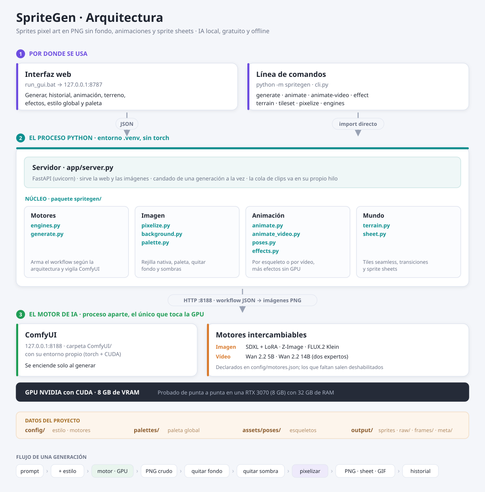

# Arquitectura de SpriteGen

Cómo está montado el proyecto por dentro, qué hace cada pieza y **por qué** los parámetros valen lo que valen. Pensado para quien vaya a tocar el código o quiera entender qué ocurre entre el prompt y el PNG final.



> Versión imagen: [arquitectura.png](arquitectura.png)

---

## 1. Los tres procesos

```
Navegador (GUI)  ←JSON→  FastAPI 127.0.0.1:8787  ←import→  paquete spritegen/
                          (app/server.py)                        ↓ HTTP :8188
                                                          ComfyUI (proceso aparte)
                                                          ← se enciende solo, con lock de fichero
```

1. **GUI web** (`app/static/`) — HTML, CSS y JavaScript sin frameworks. Solo habla JSON con el servidor local.
2. **Servidor local** (`app/server.py`, FastAPI en `127.0.0.1:8787`) — recibe las peticiones, aplica un candado de *una generación a la vez* (la GPU es una sola) y llama al núcleo. También sirve las imágenes de `output/` al navegador.
3. **Motor de IA** (ComfyUI en `127.0.0.1:8188`) — el único proceso que toca la GPU. Vive en `ComfyUI/`, con su propio entorno. El núcleo lo **arranca automáticamente** cuando hace falta y lo vigila; mientras está encendido retiene unos 9 GB de RAM, así que se puede apagar desde la GUI o con `stop_comfyui.bat` y volverá a encenderse solo en la siguiente generación.

La **CLI** (`python -m spritegen`) importa el núcleo directamente, sin pasar por el servidor: GUI y CLI son dos puertas al mismo código, y todo lo que hace una lo hace la otra.

### Por qué ComfyUI va en un proceso aparte

Cargar y descargar modelos de 10 GB es lento y frágil. Manteniéndolo como servicio HTTP independiente, el servidor de la GUI se puede reiniciar mil veces sin volver a cargar nada en la GPU, y una generación que ya está en marcha sobrevive aunque cierres el navegador.

---

## 2. Los dos entornos virtuales

| Entorno | Contenido | Quién lo usa |
|---|---|---|
| `.venv/` | pillow, numpy, requests, fastapi, uvicorn, pydantic (~50 MB) | **Todo** el proyecto: GUI, servidor y CLI |
| `ComfyUI/.venv/` | torch con CUDA, transformers, etc. (varios GB) | Solo el proceso de ComfyUI |

Están separados a propósito: el núcleo de SpriteGen no importa torch en ningún momento — todo el cálculo pesado ocurre dentro de ComfyUI, al otro lado de una llamada HTTP. Por eso el entorno del proyecto se instala en segundos y su `requirements.txt` cabe en seis líneas.

### La etiqueta de CUDA del torch de ComfyUI

El wheel de torch para Windows lleva dentro su propio runtime de CUDA, y la etiqueta del índice del que se instala (`cu126`, `cu130`…) fija para qué generaciones de GPU trae kernels compilados. `cu126` llega hasta Hopper (`sm_90`) y **no incluye Blackwell (RTX 50, `sm_120`)**: con esas tarjetas ComfyUI arranca, torch ve la GPU, y el primer nodo que calcula falla con `CUDA error: no kernel image is available for execution on the device`. Es un error de instalación, no del workflow, y `torch.cuda.get_arch_list()` lo revela en un segundo.

Reglas que se siguen aquí: instalar siempre desde `--index-url https://download.pytorch.org/whl/cu130` (en Windows el torch de PyPI es solo CPU); mantener torch, torchvision y torchaudio con la misma etiqueta, porque torchvision trae kernels propios; no instalar el CUDA Toolkit (basta el driver, y un toolkit en el PATH puede colisionar con las DLL del wheel); y apagar ComfyUI antes de reinstalar, porque pip no puede sustituir DLL en uso.

---

## 3. Mapa de módulos (`spritegen/`)

| Módulo | Responsabilidad |
|---|---|
| `engines.py` | Motores intercambiables: lee `config/motores.json`, comprueba qué está instalado y **construye el workflow de ComfyUI** para cada arquitectura (`sdxl`, `zimage`, `flux2`, `wan22`, `wan22_moe`, `trellis2`, `pixal3d`) |
| `generate.py` | Orquestador: lanza el workflow, vigila la cola con sondeo robusto (detecta trabajos perdidos vía `/queue` y cancela huérfanos con `/interrupt`) y remata la generación (fondo → sombra → pixelizado → metadatos). Recoge las salidas de cualquier tipo (imágenes o modelos GLB), libera la memoria de ComfyUI al cambiar entre familias pesadas (vídeo ↔ 3D) e incluye el arranque automático de ComfyUI con lock anti doble arranque |
| `model3d.py` | Imagen → modelo 3D texturizado (GLB): separa el sujeto del fondo, corre TRELLIS.2, limpia los metadatos que ComfyUI incrusta en el GLB y registra la pieza con su miniatura. Y el camino de vuelta: convierte los renders de cada dirección en sprites con recorte y paleta comunes |
| `livefeed.py` | Escucha el **WebSocket de ComfyUI** durante cada workflow: paso de muestreo (`progress`) y preview del latente a medio desruido, que la GUI muestra como barra de progreso real y miniatura en vivo. Canal informativo puro: si falta `websocket-client` o la conexión falla, todo sigue funcionando |
| `pixelize.py` | El corazón del pixel art: rejilla nativa, cuantización, alfa duro, limpieza de píxeles sueltos y reescalado *nearest* |
| `background.py` | Tres detectores independientes: fondo plano, sombra difusa y sombra de contacto |
| `palette.py` | Paleta global del proyecto (`palettes/proyecto.txt`, un color hex por línea, compatible con Lospec) |
| `animate.py` | Animación por **esqueleto**: ControlNet OpenPose sobre SDXL, misma semilla y paleta compartida entre frames |
| `animate_video.py` | Animación por **vídeo**: un modelo imagen→vídeo genera un clip y de ahí se muestrean los frames. Incluye el encadenado de clips |
| `poses.py` | Esqueletos OpenPose procedurales: 12 ciclos (caminar e *idle* en tres vistas, más seis acciones), ampliables con carpetas propias |
| `effects.py` | Animaciones sin GPU con bucle perfecto: mecer, fuego, tela ondeando, humo |
| `terrain.py` | Tiles de 64 px *seamless*, 16 transiciones Wang por máscara de esquinas y exportación de tileset |
| `sheet.py` | Empaqueta frames en un sprite sheet |
| `web3d.py` | Versión web de un modelo 3D con `gltf-transform` (Node, en `tools/gltf/`): malla simplificada, geometría meshopt y texturas WebP |
| `ocultos.py` | El atributo «oculto» de Windows y la reescritura segura de fichas ocultas, compartidos por el servidor y la CLI |
| `headless.py` | Navegador sin ventana para la CLI: abre Chrome (o Edge) en modo *headless*, lo controla por el protocolo de DevTools y recoge el resultado de la página. Lo usa el horneado 3D, que es WebGL |
| `importer.py` | Registra imágenes ajenas como entradas `sprite` del historial (original + copia + ficha), tal cual |
| `cli.py` | La línea de comandos, espejo de todas las funciones de la GUI |

---

## 4. Carpetas de datos

```
config/estilo.json       estilo global (plantilla de prompt, negative, umbrales)
config/motores.json      registro de motores
config/vista.json        estado de la vista (no se versiona)
palettes/proyecto.txt    paleta global del proyecto
assets/poses/<ciclo>/    esqueletos OpenPose; _previews/ = caché de GIFs
output/                  sprites finales
  ├── raw/               imágenes tal cual salen de la IA
  ├── frames/<slug>/     frames sueltos de cada animación
  ├── meta/*.json        metadatos de cada generación
  ├── models/            modelos 3D (GLB)
  └── terrain/<id>/      tiles base de cada terreno
app/static/vendor/three/ Three.js copiado en local para el visor 3D (sin internet)
```

---

## 5. El flujo de una generación

```
prompt → plantilla de estilo → motor elegido en la GPU → PNG crudo (output/raw/)
       → quitar fondo → quitar sombra → pixelizar (rejilla + paleta + alfa duro)
       → PNG final + metadatos → historial de la GUI
```

En las animaciones por esqueleto, los pasos centrales se repiten por frame con la **misma semilla** y la **paleta del primer frame**: eso es lo que mantiene la identidad y la cohesión del ciclo. En las de vídeo, el modelo genera el clip entero y los frames se muestrean de él, así que la coherencia viene de fábrica.

---

## 6. Sistema de motores

Un «motor» es una combinación de modelo, arquitectura y parámetros. Se declaran en `config/motores.json` y la GUI puebla su selector desde ahí: los que no tienen sus archivos descargados salen deshabilitados y **se activan solos** en cuanto aparecen en `ComfyUI/models/`.

```jsonc
{
  "id": "klein4b",
  "label": "FLUX.2 Klein 4B · calidad + edición",
  "kind": "image",              // image | video | model3d
  "arch": "flux2",              // qué constructor de workflow usar
  "files": {                    // "a|b" = alternativas válidas
    "diffusion_models": ["flux-2-klein-4b-fp8.safetensors"],
    "text_encoders":    ["qwen_3_4b.safetensors"],
    "vae":              ["flux2-vae.safetensors"]
  },
  "params": { "steps": 4, "cfg": 1.0, "width": 1024, "height": 1024 }
}
```

La comprobación de instalación es deliberadamente simple: mira si el archivo existe en la carpeta que le toca. Ojo, **una descarga a medias cuenta como instalada**.

### Recetas por arquitectura

Cada `arch` construye un grafo de nodos distinto. Las recetas no son inventadas: salen de las plantillas oficiales que trae el propio ComfyUI (`ComfyUI/blueprints/*.json`), que es el método a seguir para añadir motores nuevos — leer el blueprint, no adivinar.

| `arch` | Receta |
|---|---|
| `sdxl` | Checkpoint + LoRA clásicos, KSampler con CFG real y negative prompt efectivo |
| `zimage` | UNETLoader + CLIPLoader tipo `lumina2`, muestreo `res_multistep`, 9 pasos, **cfg 1** |
| `flux2` | Modelo destilado con `Flux2Scheduler` + `SamplerCustomAdvanced`; 4 pasos para generar, 8 para editar. La **edición por referencia** inyecta la imagen con `ReferenceLatent` en el condicionado, y el latente de salida debe medir lo mismo que la referencia |
| `wan22` | Imagen→vídeo con un solo modelo. La longitud del clip debe ser **4n+1** (81, 121…), que es lo que exige su VAE temporal |
| `wan22_moe` | Imagen→vídeo con **dos expertos** (*high noise* y *low noise*) muestreados en cadena: el primero trabaja hasta un paso frontera y le pasa el latente al segundo. Nunca están los dos en memoria a la vez |
| `trellis2` · `pixal3d` | Imagen→3D en tres muestreos encadenados con el KSampler estándar —estructura dispersa, forma (a 512 y en cascada a la resolución final) y textura— y un postproceso de malla: remallado, decimado, desplegado UV y horneado de color, relieve y oclusión, hasta un GLB. Sale de la plantilla oficial `3d_pixal3d_trellis2_image_to_model.json` del paquete de plantillas de ComfyUI |

### Cuando el negative prompt no sirve para nada

Los modelos destilados (`zimage`, `flux2`, y `wan22_moe` con sus LoRA de aceleración) trabajan con **cfg = 1**. Matemáticamente, con cfg 1 la rama negativa se ignora por completo: el negative prompt está conectado en el grafo porque así viene en las plantillas oficiales, pero **no influye en la imagen**. Afinarlo es perder el tiempo; para que cuente habría que renunciar a los LoRA de aceleración y subir a ~20 pasos con cfg 3,5–5, multiplicando el tiempo por cinco.

### Modelos cuantizados (`.gguf`)

Los archivos `.gguf` no los cargan los nodos estándar: hacen falta `CLIPLoaderGGUF` y `UnetLoaderGGUF`, de la extensión ComfyUI-GGUF. El código detecta la extensión del archivo y conmuta de nodo solo. Los modelos de difusión cuantizados van en `ComfyUI/models/diffusion_models/` (no en `unet/`, aunque algunos repositorios lo digan).

### La regla de oro de los LoRA

**Un LoRA solo sirve para la arquitectura exacta con la que se entrenó, y ComfyUI no falla al aplicar el equivocado: sigue adelante como si nada.** Un LoRA de un modelo de 14 000 M de parámetros aplicado sobre uno de 5 000 M descarta unas capas por nombre y otras por forma, y acaba no aplicándose en absoluto — con resultados mediocres y ningún error visible.

Antes de registrar un LoRA, comprueba su arquitectura leyendo la cabecera del `.safetensors` (número de bloques y dimensión). Y ante resultados malos, busca en `ComfyUI/comfyui.log` las líneas `lora key not loaded` y `ERROR lora` **antes** de tocar ningún parámetro.

---

## 7. Los dos métodos de animación

| | **Esqueleto** (ControlNet) | **Vídeo** (imagen→vídeo) |
|---|---|---|
| Cómo | Un esqueleto OpenPose por frame guía la pose | Un modelo genera un clip y se muestrean frames |
| Control de la pose | Total: la pose es exactamente la que dibujas | Ninguno: se describe el movimiento con palabras |
| Identidad entre frames | Buena (misma semilla + paleta compartida) | Perfecta: es literalmente el mismo sujeto moviéndose |
| Coste | ~1 minuto por frame | Varios minutos por clip |
| Flojea en | Poses muy forzadas | Caras y manos en movimientos rápidos |

Para ciclos que deben cerrar (caminar, *idle*), el método de vídeo muestrea **una sola zancada** con paso entero, de modo que el bucle case. Para movimientos que empiezan y terminan (ataque, muerte) se recorre el clip completo.

---

## 8. Historial y metadatos

Cada generación escribe un `output/meta/<nombre>.json` con el prompt, la semilla, el motor y los parámetros. Hay cinco tipos: `sprite`, `animation`, `terrain`, `tileset` y `model3d` (el GLB en `output/models/`, una miniatura isométrica y una copia propia de la imagen de partida, para que borrar el sprite base no deje al modelo sin su origen).

**La ficha es la que existe, no la imagen**: el historial se construye leyendo `output/meta/*.json`, así que un PNG suelto en `output/` es invisible. Por eso las imágenes ajenas entran por `importer.py` (`POST /api/import` en la GUI, `spritegen import` en la CLI), que crea los tres archivos de una entrada `sprite` a la vez: el original en `output/raw/`, la copia visible en `output/` y la ficha, con `engine: null` e `imported: true`. Se guardan tal cual (RGBA, con la rotación EXIF aplicada), sin recorte de fondo ni pixelizado, porque no se sabe qué son. El servidor las recibe como data URL dentro del JSON: el venv no trae `python-multipart` y las imágenes son pequeñas.

Dos garantías del sistema de archivos:

- **Nada se sobrescribe jamás**: si el nombre ya existe, se añade un sufijo `_v2`, `_v3`… comprobando los metadatos.
- **Borrar del historial borra de verdad**: elimina el PNG, el original, los frames, el sheet y los metadatos. No hay papelera.

**Ocultar** un elemento (👁) actúa en dos capas: desaparece de la interfaz *y* sus archivos reciben el atributo «oculto» de Windows, para que tampoco se vean en el Explorador. Lo derivado de un elemento oculto nace oculto: si no, animar un sprite escondido lo destaparía por la puerta de atrás.

---

## 9. Decisiones de parámetros (y por qué)

### Rejilla nativa y escala

El pixel art **no se dibuja a 1000×1000**. Se trabaja a 96–256 px reales y se escala ×4–×8 con *nearest*. La rejilla nativa es la que da el «detalle»; la escala solo agranda para verlo cómodo. Referencias útiles: personaje 128 px (dos tiles de 64), edificio 192–256, prop pequeño 64.

### Cuantización de color

La reducción de paleta usa *median cut* **refinado con k-means determinista**, lo que baja el error de color a la mitad respecto a *median cut* a secas. Dos detalles que importan: los píxeles transparentes se rellenan con el color medio **antes** de cuantizar (si no, el negro del vacío contamina la paleta), y el mapeo final se hace exacto en numpy.

### Fondo transparente

Se le pide al modelo un fondo blanco liso y luego se elimina por *flood fill* conectado desde los bordes, **con una guarda de croma**: un píxel solo cuenta como fondo si se parece al color de fondo por igual en los tres canales. Sin esa guarda, el flood se cuela por la piel y los tonos cálidos claros y vacía los brazos por dentro. Nunca se usa fondo magenta: contamina el contorno del sujeto.

### Sombras

Los modelos pintan una sombra bajo el sujeto aunque el prompt lo prohíba, así que se quita después con tres detectores distintos. El de sombras difusas mide el gradiente **solo entre píxeles ambos visibles** y borra únicamente componentes **chatas** (más anchas que altas): así una espada clara y vertical se conserva en lugar de desaparecer.

### `pixelize_method` por motor

Cada motor declara cómo reducir a la rejilla: `nearest` conserva los pseudo-píxeles que ya produce SDXL con su LoRA de pixel art, mientras que `box` limpia mejor las salidas suaves de los modelos modernos. Elegir mal se nota: `nearest` sobre una imagen suave deja bordes sucios.

### Vídeo: resolución y duración compiten por la misma memoria

Lo que llena la VRAM en un modelo de vídeo no son los pesos, sino las **activaciones**, y su tamaño depende de `ancho × alto × frames`. La relación **no es lineal: hay un acantilado** en cuanto el buffer deja de caber en la VRAM. Medido en una GPU de 8 GB con 32 GB de RAM del sistema:

| Resolución × frames | Mpx·frame | Segundos por paso | Total |
|---|---|---|---|
| 624×624×121 | 47,1 | 76 | 7 min ✔ |
| **768×768×81** | **47,8** | **81** | **6:51 ✔ — el punto dulce** |
| 768×768×121 | 71,4 | **612** | **31 min** ⚠ |
| 960×960×121 | 111,5 | — | se atasca ✘ |

La carga sube 1,5× entre la segunda y la tercera fila, pero **el tiempo por paso se multiplica por 7,5**. La regla práctica: no pasar de **~48 Mpx·frame**.

Consecuencia importante: **para clips más largos, encadenar tramos en vez de subir la duración**. Dos tramos de 5 s cuestan unos 14 minutos; el mismo clip pedido de una vez, 31. El encadenado arranca cada tramo del último frame del anterior y descarta ese frame duplicado.

### Imagen→3D: lo que cabe en 16 GB

La plantilla oficial de TRELLIS.2 no cabe en una GPU de 16 GB. Medido:

| Ajuste | Resultado |
|---|---|
| Cascada de forma a 1536 | El muestreo de esa etapa va a 26 s por paso y después el remallado agota la VRAM |
| Cascada a 1024 con remallado a 768 | El remallado sigue agotando la VRAM |
| Cascada a 1024 con remallado a 512 | 4–5 minutos por modelo… pero con algunas semillas el remallado vuelve a agotar la VRAM: su consumo crece con la malla que sale del VAE, que cambia en cada generación |
| **Lo anterior, reduciendo antes la malla a 2 millones de vértices** (`precluster_max_verts`) | **Unos 3 minutos** con 200 000 caras y texturas de 2048 px, sin pérdida visible, incluida la semilla que fallaba |
| Sin remallado | Funciona, pero sale peor y tarda más: decimar la malla en bruto cuesta dos minutos |

Si aun así se acaba la memoria, `model3d.py` repite el trabajo remallando a 384 y luego a 256. Tras un error de memoria ComfyUI descarga todos los modelos y su caché no sobrevive, así que el reintento repite también los muestreos.

Otras dos decisiones salen de comparar resultados:

- **La entrada es la imagen original, no el sprite pixelizado.** Con la misma casa como entrada, la versión pixelizada produjo una textura manchada y saturada. El pixelizado va después, al sacar sprites del modelo.
- **TRELLIS.2 sí, Pixal3D solo como laboratorio.** TRELLIS.2 deja el objeto recto y alineado con los ejes (aunque qué cara queda de frente cambia de una generación a otra); Pixal3D lo reconstruye desde la cámara de la imagen, así que sale inclinado y, al suponer perspectiva, deforma las imágenes isométricas.

`RenderMesh`, el render nativo de ComfyUI, solo hace perspectiva y no ilumina las texturas: sirve para la miniatura del archivo, no para hornear sprites. El visor del vidrio usa Three.js con cámara ortográfica y la luz pegada a la cámara.

### Horneado 3D → sprites

El horneado se pinta **en el navegador**, con el mismo Three.js que muestra el modelo, y el servidor solo pixeliza. Así lo que se encuadra es lo que sale, y el render es el mismo que tendría el modelo en una escena web.

- **Un solo encuadre para todas las direcciones.** Al cargar el modelo se guardan sus vértices; para hornear se proyectan en cada dirección y la cámara ortográfica toma la caja que las contiene a todas. Con eso el origen del modelo cae en el mismo píxel de cada sprite y el objeto no cambia de tamaño al girar. Después el servidor recorta la unión de lo visible, igual para todos.
- **Una sola paleta.** Las direcciones se cuantizan juntas, en una tira, y esa paleta se aplica a cada una: si cada dirección eligiera la suya, el mismo tejado cambiaría de tono al girar.
- **Escala por tiles.** TRELLIS.2 entrega todos los modelos normalizados al mismo cubo, así que sin una referencia una choza y un castillo saldrían igual de grandes. Los píxeles por unidad salen de cuántos tiles ocupa la planta: `tile_px / (planta / tiles)`, y en las vistas diagonales se divide además por √2, porque el ancho del rombo de un tile isométrico es la diagonal del cuadrado.
- **Un renderizador propio.** El horneado crea su propio `WebGLRenderer`: el mapa de entorno pertenece al contexto WebGL que lo generó y no se puede compartir, aunque la geometría y los materiales sí (se clona el modelo sin copiarlos).
- **Supermuestreo.** Se pinta a 4× la rejilla (o lo que quepa en 4096 px) con antialiasing, y la reducción *box* del pixelizador da bordes limpios.
- **La misma vía para la interfaz y la línea de comandos.** El cálculo de la escala y el horneado completo (orientar, iluminar, pintar y enviar) viven en el módulo del visor. La interfaz los llama desde la hoja 3D; `spritegen bake3d` abre una página de servicio (`hornear.html`) en un Chrome sin ventana que llama a esas mismas funciones. Por eso los dos caminos dan un resultado idéntico píxel a píxel. La CLI usa el servidor de la interfaz si está abierto y, si no, levanta uno temporal dentro de su propio proceso.

### Versión web: el GLB maestro no se toca

El modelo que sale de TRELLIS.2 se conserva como **maestro**, y las versiones web son copias derivadas (`<nombre>_web.glb`, `<nombre>_ligero.glb`) que se apuntan en su ficha y se borran u ocultan con él. Dos razones:

- **Las versiones web dependen de extensiones** (`EXT_meshopt_compression`, `EXT_texture_webp`, `KHR_mesh_quantization`) que Three.js lee pero no todos los importadores. El maestro sirve para cualquier herramienta.
- **El horneado a sprites parte siempre del maestro**, con sus texturas completas. Por eso el visor espera a la carga en curso antes de hornear: si se estaba mostrando la versión web, se hornea el maestro igualmente.

La salida de `gltf-transform` es determinista, así que una versión que ya existe se reutiliza en vez de rehacerse.

### La RAM libre decide el tiempo, no la VRAM

Con dos expertos de 10 GB que se turnan, lo que cuesta caro es el trasiego entre RAM y VRAM. Con 316 MB de RAM libre, el cambio de experto tardó 44 minutos; con 1,5 GB, **1 minuto y 21 segundos**. El cálculo puro va igual de rápido en ambos casos. Antes de una tanda larga conviene cerrar el navegador — el trabajo lo hace el servidor, no la pestaña — y reiniciar ComfyUI si lleva horas encendido.

### Formatos de salida

- **Pixel art → GIF**: 256 colores sobran de largo y es lo que esperan las herramientas de sprites.
- **Vídeo sin pixelizar → WebP animado**: medido sobre un clip real de 201 frames, **57,3 MB en GIF frente a 7,1 MB en WebP**, y con 28 620 colores por frame en lugar de 256. El navegador lo reproduce igual dentro de un ``.

Un detalle poco conocido: los frames de un GIF comparten una paleta global calculada a partir del **primer** frame. En un clip largo, los tramos finales acaban pintados con los colores del arranque.

### Orden de los frames

Los frames se ordenan **numéricamente**, no alfabéticamente. Con orden alfabético, `frame_100` cae detrás de `frame_10` y desordena cualquier clip de más de 100 frames.

### Progreso en vivo por WebSocket

La API REST de ComfyUI no expone el paso de muestreo: `/history` solo dice «pendiente» o «terminado». El paso actual (`{"value": 14, "max": 28}`) y los previews del latente a medio desruido viajan únicamente por su WebSocket (`ws://<server>/ws`), y de ahí salen la barra de progreso real y la miniatura en vivo de la GUI (`livefeed.py` → `GET /api/live` y `/api/live/preview.jpg`). Detalles que costaron su depuración:

- **El `client_id` del `POST /prompt` debe coincidir con el `clientId` del WebSocket**: ComfyUI dirige `progress` y previews solo al socket registrado con ese id. Aquí el id lleva el PID para que dos procesos (CLI y GUI) no se desregistren entre sí.
- **Una sola conexión persistente por proceso, no una por workflow**: el handler de ComfyUI hace `sockets.pop(sid)` al cerrar una conexión, así que reconectar con el mismo id puede desregistrar la conexión nueva si el cierre de la vieja se procesa después (carrera real).
- Los previews requieren arrancar ComfyUI con `--preview-method auto` (sin él, el método por defecto es `none`). `auto` cae en *latent2rgb* —una proyección lineal por píxel— cuyo coste es despreciable; emite un JPEG por paso como frame binario `[4B evento][4B formato][imagen]`.
- El WebSocket es **solo informativo**: quien decide cuándo terminó un trabajo sigue siendo el sondeo HTTP, que además sobrevive a reinicios de ComfyUI (el socket moriría sin decir qué pasó con el trabajo).

---

## 10. Notas de Windows

- Un archivo con el atributo «oculto» **no se puede reescribir** con las funciones normales de Python: hay que desmarcarlo, escribir y volver a marcarlo. Si no, ocultar algo y luego modificarlo falla con «acceso denegado».
- Si alguna vez quedan archivos ocultos descuadrados, esto los devuelve a la visibilidad: `attrib -H /S /D output\*`

---

## 11. Cómo verificar un cambio

1. `python -m py_compile` de los módulos tocados.
2. **Reiniciar el servidor**: uvicorn corre sin `--reload`, así que los cambios en `app/server.py` o en `spritegen/` no se recargan solos. Los de HTML sí: basta F5. Los de **CSS y JavaScript exigen subir el token de versión** de sus enlaces en `index.html` (`style.css?v=…`, `app.js?v=…`): sin eso el navegador reutiliza el JavaScript cacheado y lo mezcla con el HTML nuevo, lo que produce errores desconcertantes sobre elementos que sí existen en la página.
3. Probar los endpoints afectados.
4. Si el cambio toca la generación, una prueba real en GPU y mirar el PNG resultante. En pixel art, muchos fallos solo se ven mirando.
